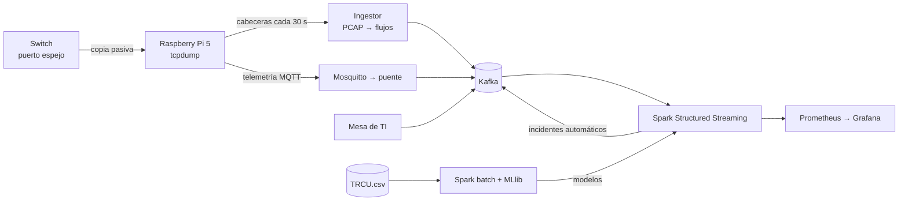

# NIDS campus — tráfico de red en tiempo real

Sistema Big Data para **detectar a tiempo comportamientos anómalos en el tráfico
de red de un laboratorio de la UPeU**. Un Raspberry Pi 5 conectado a un puerto
espejo captura pasivamente; la nube convierte el tráfico en flujos, lo procesa
con Kafka + Spark Structured Streaming, lo compara con modelos entrenados con
2 meses de tráfico real de la universidad y muestra en Grafana el tráfico, su
predicción y las anomalías, que se convierten solas en tickets de incidente.

**Equipo:** Nick Saim Mayta Jara · David Romero Nina · Henyelrey Lucio Garcia Chura · Jhan Logan Ramos Quispe
**Curso:** Big Data · UPeU 2026-2

📘 **Documentación completa:** https://davidromeron.github.io/NIDS/



## Resultados

| Integrante | Indicador | Modelo ganador | Mejora del RMSE vs persistencia (test ciego) |
|---|---|---|---:|
| David Romero | bytes/min | GBT (escala log) | +16,2 % |
| Nick Mayta | flujos/min | Random Forest | +45,8 % |
| Henyelrey Garcia | SYN/min | GBT (escala log) | +11,6 % |
| Jhan Ramos | DNS/min | Random Forest (escala log) | +17,6 % |

Detector de anomalías por flujo: K-Means con k = 6 (silhouette 0,83), umbral
en el percentil 99,5 de 397 354 flujos históricos.

## Estructura

```text
nube/            stack de la nube (Docker Compose)
  app/           ingestor PCAP→flujos, puente MQTT→Kafka, productor de incidentes
  spark/jobs/    streaming, entrenamiento de series de tiempo, K-Means, preparación del histórico
  grafana/       tablero como código
  desplegar.sh   prepara la VM y levanta todo
pi/              sensor: instalador, servicios systemd, scripts de captura y subida
notebooks/       5 notebooks PySpark ejecutados con datos reales (ETL + uno por integrante)
docs/            sitio MkDocs (se publica solo con GitHub Actions)
```

## Puesta en marcha

```bash
# VM (Ubuntu 24.04, 2 vCPU / 8 GB)
git clone https://github.com/DavidRomeroN/NIDS.git && cd NIDS/nube
sudo ./desplegar.sh

# Raspberry Pi 5 (Raspberry Pi OS Lite 64-bit)
sudo ./instalar.sh --vm <IP_DE_LA_VM>
```

Detalle completo en [Despliegue reproducible](docs/despliegue.md).

## Datos y privacidad

El histórico `TRCU.csv` y las capturas **no están en el repositorio** (contienen
IP institucionales, Ley 29733). En la nube solo viajan cabeceras y las IP se
seudonimizan con HMAC antes de entrar a Kafka.
