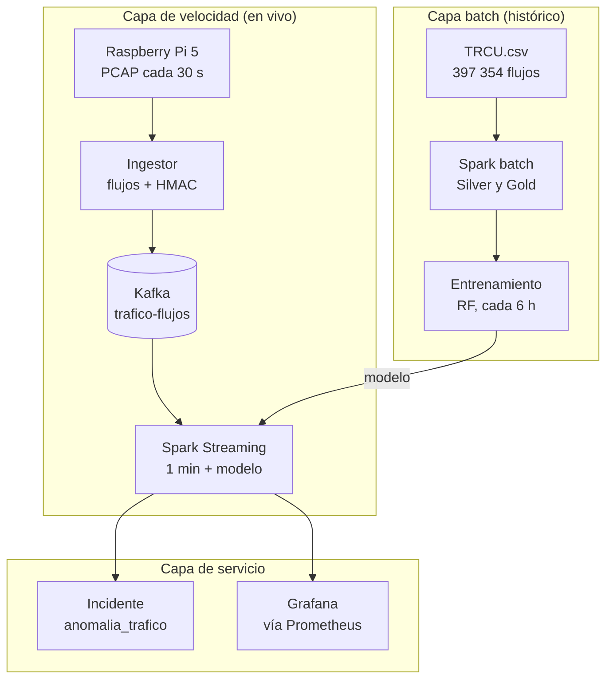

# NIDS campus — Caso Nick Mayta: flujo, gráficas y guión de exposición

30-oct-2026 · Nick Saim Mayta Jara · Curso Big Data, UPeU 2026-2

## Glosario

Leer esto primero: son los términos que se repiten en el proyecto, definidos como se usan aquí.

**Red y datos**

| Término | Qué significa en este proyecto |
| --- | --- |
| Flujo (flow) | Una conexión entre dos equipos resumida en una fila: quién, hacia qué puerto, cuántos paquetes y bytes, cuánto duró. Tu indicador cuenta flujos nuevos por minuto. |
| 5-tupla | IP origen, IP destino, puerto origen, puerto destino y protocolo. Identifica un flujo. |
| Puerto espejo (SPAN) | Puerto del switch que recibe una copia de todo el tráfico. El Raspberry Pi solo escucha; no bloquea nada. |
| PCAP | Archivo con paquetes capturados (lo genera tcpdump). El Pi guarda uno cada 30 s. |
| TCP / UDP | TCP abre una conexión con un saludo (SYN) y confirma lo recibido. UDP envía sin abrir conexión; es típico de anuncios y descubrimiento. |
| SYN | Paquete que inicia una conexión TCP. Muchos SYN sin respuesta pueden indicar un escaneo. |
| Broadcast / multicast | Mensajes dirigidos a todos o a un grupo de equipos de la red local. No salen a internet. |
| Puertos 10001, 5353, 5355, 137/138, 56700 | Descubrimiento local: 10001 = descubrimiento de equipos Ubiquiti; 5353 = mDNS; 5355 = LLMNR; 137/138 = NetBIOS; 56700 = focos LIFX. |
| TRCU.csv | Histórico capturado por el equipo en la universidad (1-jul a 1-sep-2026): 397 354 flujos y 83 columnas, sin etiquetas (`label = NeedLabel`). |
| Seudonimización HMAC | Cambiar cada IP por un código fijo (`h-xxxxxxxxxxxx`) con una clave secreta. La misma IP da siempre el mismo código (Ley 29733). |

**Big Data**

| Término | Qué significa en este proyecto |
| --- | --- |
| Arquitectura Lambda | Dos caminos sobre el mismo dato: capa batch (histórico, entrena modelos), capa de velocidad (tráfico en vivo, aplica modelos) y capa de servicio (Grafana e incidentes). |
| Bronze / Silver / Gold | Bronze = dato crudo (CSV). Silver = un flujo por fila, limpio y tipado. Gold = una fila por minuto con los indicadores. |
| Parquet particionado | Formato columnar guardado en una carpeta por fecha. Filtrar por fecha lee solo esa carpeta (*partition pruning*). |
| Kafka | Bus de mensajes. Tópico = canal (`trafico-flujos`); partición = subdivisión del tópico; key = campo que decide la partición; offset = posición del mensaje; lag = mensajes que Kafka tiene y Spark aún no procesó. |
| Spark Structured Streaming | Spark procesando en micro-batches (aquí cada 20 s) lo que llega a Kafka. |
| Ventana fija de 1 min | Cada flujo se cuenta en el minuto en que empezó. Es la unidad de tu serie de tiempo. |
| Watermark (4 min) | Cuánto atraso tolera Spark antes de cerrar una ventana. Un flujo que llega después se descarta. |
| Checkpoint | Copia del avance de cada consulta: si el contenedor se reinicia, sigue donde quedó. |
| Prometheus / Pushgateway / Grafana | Spark empuja métricas a Pushgateway, Prometheus las guarda y Grafana las dibuja. |
| MTTR | Tiempo promedio de resolución de un incidente. |

**Modelos**

| Término | Qué significa en este proyecto |
| --- | --- |
| Persistencia | Baseline: predecir que el minuto siguiente será igual al actual. Un modelo debe ganarle para justificarse. |
| Rezago (lag) y media móvil | Valores de los minutos anteriores (lag1, lag2, lag3) y su promedio de 5 min. Dan memoria al modelo. |
| Validación cruzada temporal | Entrenar siempre con el pasado y validar con el futuro inmediato (3 cortes). Nunca se mezcla al azar. |
| Test ciego | El último 20 % del tiempo (5 264 min); no participa en ninguna decisión. |
| RMSE / MAE / R² | RMSE y MAE = error en las unidades del indicador (flujos/min); RMSE castiga más los errores grandes. R² = 1 es perfecto, 0 equivale a predecir siempre el promedio, negativo es peor que eso. |
| Escala log | Entrenar con log(1+x) y volver con exp(x)-1. Ayuda cuando hay picos muy grandes. En tu indicador ganó la escala original. |
| Random Forest | Muchos árboles de decisión que votan; en tu caso 40 árboles de profundidad 10. |
| Importancia de variables | Cuánto usa el modelo cada variable. Indica qué mira, no por qué ocurre algo. |
| Umbral de anomalía | Predicción + 3 × RMSE de test. Si el valor real lo supera, se marca anomalía y se abre un incidente. |
| z-score por hora | Cuántas desviaciones se aleja un minuto de lo normal para su hora del día. Se usa en la tabla de picos del notebook. |
| K-Means, silhouette, percentil 99,5 | Detector no supervisado por flujo (k = 6, silhouette 0,83); marca como sospechoso el 0,5 % más lejano a su grupo. |

## Tu caso en pocas líneas

Tu dimensión es **Conexiones nuevas**: cuenta cuántos flujos se abren por minuto en el laboratorio y predice cuántos habrá el minuto siguiente. Tu rol en el equipo es la arquitectura Lambda y la observabilidad general.

- **Pregunta central del proyecto:** ¿cómo detectar a tiempo comportamientos anómalos en el tráfico del laboratorio para que la mesa de TI reaccione antes de que sean incidentes?
- **Tu pregunta U1 (batch):** ¿cuántas conexiones se abren, hacia qué servicios y cuánto duran? Se responde en el notebook 02 con el histórico.
- **Tu pregunta U2 (streaming):** ¿se está disparando la cantidad de conexiones ahora? Se responde en Grafana, fila "Dimensión 2 (Nick Mayta)".
- **Modelo en vivo:** Random Forest (40 árboles, profundidad 10, escala original) con rezagos. En test ciego: RMSE 5,60 frente a 10,32 de la persistencia (+45,8 %), MAE 2,93 y R² 0,63.
- **Por qué importa:** un salto de conexiones sin salto de bytes es la señal típica de escaneo o malware.
- **Datos:** 397 354 flujos en 34 751 minutos de 43 días (1-jul a 1-sep-2026), promedio 11,4 flujos/min, p99 = 46, máximo 148.

## Flujo paso a paso (flujos por minuto)

Tu indicador nace en el Raspberry Pi, se cuenta en Spark y llega a Grafana entre 1 y 5 minutos después (bloque de 30 s + cierre del flujo + watermark). Estas son las etapas y el archivo donde ocurre cada una.

El modelo se entrena en la capa batch con el histórico, viaja a Spark Streaming y se aplica a cada ventana de 1 minuto; el resultado va a Grafana y, si hay desvío, a un incidente.

| # | Etapa | Archivo(s) | Qué hace con tu indicador | Salida |
| --- | --- | --- | --- | --- |
| 0 | Captura | `pi/bin/nids-captura.sh`, `nids-subida.sh`, `pi/systemd/*.service` | tcpdump en el puerto espejo, un PCAP cada 30 s (512 B por paquete en disco local). `editcap` recorta a 128 B (solo cabeceras), comprime y sube por SFTP. | PCAP `.gz` en la VM |
| 1 | Telemetría del sensor | `pi/bin/nids-telemetria.py`, `nube/app/bridge_mqtt_kafka.py` | Cada 5 s temperatura, CPU y paquetes descartados viajan por MQTT, puente y Kafka (`pi-telemetria`). | Base de tu panel de salud del sensor |
| 2 | Ingesta | `nube/app/ingestor_pcap.py` | Reconstruye flujos por 5-tupla. Un flujo termina con FIN/RST, 30 s sin paquetes o 2 min. Seudonimiza las IP y publica un evento por flujo en `trafico-flujos` (key = `src_addr`, 3 particiones). | Cada evento = 1 unidad de tu indicador |
| 3 | Histórico (batch) | `notebooks/00_etl_batch_trcu.ipynb`, `nube/spark/jobs/preparar_historico.py` | Lee TRCU.csv (397 354 × 83), valida calidad (0 nulos, 0 duplicados, 0 negativos), tipa, seudonimiza y escribe Silver y Gold en Parquet por fecha. | Silver 397 354 filas; Gold 34 751 filas; 43 particiones |
| 4 | Agregación común | `nube/spark/jobs/comun.py` → `agregar_por_minuto()` | Misma función en batch y streaming: `flujos` = conteo de flujos por ventana de 1 min, junto con paquetes, bytes, hosts, tcp, udp, dns, bytes_tls, syn y bytes_externos. | Una fila por minuto |
| 5 | Descriptivo y diagnóstico | `notebooks/02_nick_conexiones.ipynb`, `analisis_comun.py` | Resumen, perfil por hora, top de puertos, duración (p50/p90/p99), destino por protocolo y picos por z-score. | Gráficas y tablas (sección "Análisis de tus gráficas") |
| 6 | Predicción U1 (batch) | `analisis_comun.py` → `modelo_horario()` | Flujos de la próxima hora con lag1, lag24, hora y día; 740 horas, división cronológica 80/20; LR y RF contra la persistencia. | RF mejora 14,0 % el RMSE (179,7 vs 209,0) |
| 7 | Entrenamiento U2 | `nube/spark/jobs/entrenar_series.py` | Dataset supervisado (valor del minuto siguiente, 32 variables, 26 316 filas, solo minutos consecutivos). Validación cruzada temporal en 3 cortes, 12 configuraciones (LR, RF, GBT × escala original o log) y test ciego del 20 %. | Ganador RF; `PipelineModel` + `metricas.json`; reentrena cada 6 h |
| 8 | Streaming U2 | `nube/spark/jobs/streaming_nids.py` | Lee `trafico-flujos`, valida, ventana de 1 min con watermark de 4 min, calcula rezagos con memoria de 5 filas, predice el minuto siguiente y mide el error en vivo. Si real > predicción + 3×RMSE abre un incidente `anomalia_trafico` (severidad media, uno por motivo cada 10 min). | Métricas, Parquet `trafico_minuto` e incidentes |
| 9 | Servicio | Pushgateway → Prometheus (`prometheus.yml`) → Grafana (`generar_dashboard.ps1` → `nids.json`) | Fila "Dimensión 2 (Nick Mayta)" con 4 paneles. | Tablero con refresco de 30 s |
| 10 | Observabilidad y costos (tu rol) | `docs/observabilidad.md`, `docs/costos.md`, fila "Observabilidad" del tablero | Lag Kafka→Spark, duración de batch, latencia extremo a extremo, segundos desde el último archivo, interfaz espejo vs pipeline, CPU y RAM. Costo ~63 USD/mes. | Alarmas de salud del pipeline |
| 11 | Despliegue | `nube/compose.yml`, `nube/desplegar.sh`, `pi/instalar.sh` | 14 servicios en Docker Compose; el Pi se instala con un script. | Reproducible desde cero |

La idea que sostiene todo: el modelo ve en vivo las mismas variables con las que se entrenó porque batch y streaming comparten `agregar_por_minuto()`.

## Conexión con el curso de Big Data

Tu caso recorre las tres capas de la arquitectura Lambda del curso: el notebook 02 y el entrenamiento son la capa batch, el streaming es la capa de velocidad y Grafana más los incidentes son la capa de servicio.

| Capa Lambda | Qué es en el proyecto | Tu parte |
| --- | --- | --- |
| Batch | TRCU.csv → Silver/Gold → `entrenar_series.py` (cada 6 h) | Notebook 02 y el modelo RF de `flujos` |
| Velocidad | Kafka → Spark Structured Streaming → predicción por minuto | Consulta `trafico_ventanas_1min` |
| Servicio | Prometheus → Grafana y tópico `incidentes-seguridad` | Fila "Dimensión 2" y fila de observabilidad |
| Unión | `agregar_por_minuto()` compartida; el reentrenamiento usa histórico más `trafico_minuto` en vivo | Tu decisión de arquitectura |

Cómo se relaciona con las sesiones y unidades del curso:

| Sesión | Capacidad evaluada | Dónde aparece en tu caso |
| --- | --- | --- |
| S3 (U1) | Spark batch, Parquet particionado, Bronze/Silver/Gold, `explain()` | Notebook 00: Silver y Gold por fecha; `PartitionFilters: fecha = 2026-08-11` |
| S4 (U1) | Regresión con Spark MLlib | `modelo_horario()` del notebook 02: LR y RF para la próxima hora |
| S6 | Evento empresarial en Kafka | Tu alerta abre un incidente `anomalia_trafico` en `incidentes-seguridad` (contrato v1.1) |
| S7 | Evento IoT | Telemetría del Pi por MQTT → puente → Kafka cada 5 s |
| S8 | Streaming con ventanas, watermark y checkpoint | Ventana fija de 1 min, watermark de 4 min, checkpoint por consulta |
| S9 | Observabilidad y costos | Tu rol: lag, duración de batch, latencia, salud del sensor; ~63 USD/mes |
| S10 | Series de tiempo | Rezagos, validación cruzada temporal, persistencia como baseline; RF +45,8 % |
| S11 | BI/ML con KPIs | Real, predicción, persistencia y umbral en un mismo panel, junto a KPIs de negocio |
| S12 | Pipeline ensamblado | Todo corriendo sobre tráfico real; en el brief, el sensor se instala en la universidad el 30-oct-2026 |

**Por qué Lambda y no Kappa.** El proyecto reentrena sobre dos meses de historia (batch pesado) mientras la inferencia debe tardar segundos. Un matiz para defenderlo con criterio: Kafka retiene solo 72 h (`KAFKA_LOG_RETENTION_HOURS: 72`), así que un enfoque Kappa puro tendría que ampliar esa retención o guardar el histórico aparte. No es verdad absoluta que Lambda sea siempre mejor: es más costoso de mantener porque hay dos caminos, y el proyecto lo mitiga con una sola función de agregación.

## ¿Tu dimensión tiene pregunta clara y explicabilidad?

Sí en U2 y parcialmente en U1: la pregunta de streaming es clara y medible, pero el vínculo con "anomalía" no está probado con datos y el sistema explica qué mira el modelo, no qué conexiones causaron una alerta.

| Criterio | Veredicto | Evidencia en los archivos | Cómo plantearlo |
| --- | --- | --- | --- |
| Pregunta U2 clara y ligada a la pregunta central | Sí | "¿Se está disparando la cantidad de conexiones ahora?" se convierte en una regla: real > predicción + 3×RMSE. Con RMSE de test 5,60 el margen es 16,8 flujos. | Di la regla con el número: "alerto si hay ~17 flujos más de lo esperado". |
| Pregunta U1 clara | Parcial | Son tres preguntas en una (cuántas, hacia dónde, cuánto duran). Cada una tiene respuesta en el notebook, pero "normal" solo se define por perfil horario y z-score. | Preséntala como tres sub-preguntas, una gráfica o tabla por cada una. |
| Vínculo con "anomalía" | Parcial | La hipótesis "más conexiones sin más bytes = escaneo o malware" está escrita, pero ningún panel ni regla compara flujos contra bytes. La alerta de flujos se dispara solo con flujos (`streaming_nids.py`). | Preséntala como hipótesis de diseño; el cruce con SYN y K-Means existe en el tablero, no automatizado. |
| Validación contra eventos reales | No hay | El histórico no tiene etiquetas (`NeedLabel` en el 100 %). El pico máximo (148 flujos, 1-jul 15:00) trae 138 SYN y 2,32 de 2,35 MB en TLS: parece una ráfaga de navegación o de pruebas, no un ataque. | Di que se valida contra la persistencia, no contra ataques; la prueba en vivo es abrir muchas pestañas. |
| Explicabilidad del modelo | Parcial | Importancia de variables: `lag3_flujos` 0,224; `media5_flujos` 0,173; `lag3_bytes` 0,092; `media5_bytes` 0,089; `lag2_flujos` 0,060; `lag1_flujos` 0,055. Las 8 primeras suman 0,75. | "El modelo mira sobre todo la memoria reciente de conexiones y de bytes." |
| Explicación de cada alerta | Parcial | El incidente lleva una evidencia legible ("flujos=X supera la predicción Y + 3xRMSE") pero no dice qué puertos ni hosts causaron el salto. | Mejora posible: agregar al incidente los 3 puertos o hosts con más flujos de ese minuto. |

**Cuidado con la cifra +45,8 %.** La persistencia es un baseline débil en este indicador: su R² es −0,24 (peor que predecir siempre el promedio) y su RMSE (10,32) es casi igual al promedio de 11,4 flujos/min. El Random Forest gana sobre todo porque suaviza con rezagos y media de 5 min, como confirma la importancia de variables. No se comparó contra un baseline más justo (por ejemplo, la media de los últimos 5 min). Además, el test es más difícil que la validación: RMSE 5,60 en test contra 3,99 en validación cruzada.

La importancia de variables de un Random Forest indica qué usa el modelo, no por qué ocurre un pico. Entre rezagos correlacionados el reparto es poco confiable: que `lag3` pese más que `lag1` no significa que hace 3 minutos importe más.

## Análisis de tus gráficas y tablas

Tu indicador tiene un piso de ~8 flujos/min que no depende de las personas, y casi todo el volumen son anuncios de red local por UDP; la navegación (HTTPS) es solo el 4,5 %. Eso explica casi todas tus gráficas. El zip no trae capturas de Grafana, así que abajo analizo las gráficas de los notebooks 02 y 00 y explico cómo leer los paneles de Grafana a partir de sus consultas. Los valores leídos de una gráfica van marcados como aproximados.

**Gráficas de los notebooks**

| Gráfica | Qué muestra | Lectura | Frase para explicarla | Cuidado |
| --- | --- | --- | --- | --- |
| Flujos por minuto, promedio por hora del día (notebook 02, sección 1) | Barras por hora, día de semana frente a fin de semana. | Día de semana: ~8,6 flujos/min de 0 a 6 h, ~15 a las 8 h, pico ~18,6 a las 10 h, entre ~16 y ~18 hasta las 16 h, ~10 a las 18 h. Fin de semana: plano en ~8,1 a 8,3 todo el día (valores aproximados). | "Hay un piso de unos 8 flujos por minuto que existe de noche y en fin de semana, y un escalón de unos 9 más entre las 8 y las 17 h en días de clase. Por eso el modelo usa hora y día de la semana." | Es un promedio: oculta la dispersión. El máximo real es 148 y el p99 es 46. |
| Flujos por destino y protocolo (notebook 02, sección 2) | Barras apiladas TCP, UDP y otro, para destino "dentro del campus" y "hacia internet". | "Hacia internet" ≈ 333 mil flujos, casi todos UDP. "Dentro del campus" ≈ 63 mil, con ~20 mil TCP (valores aproximados). | "Por destino, la gran mayoría de los flujos son UDP; el TCP, que es la navegación, es una parte pequeña." | Ver el cuidado 1 debajo: la etiqueta "hacia internet" no es exacta. |
| Flujos/día, panel "Flujos/día (Nick)" (notebook 00, sección 6) | Una barra por día con captura, 1-jul a 1-sep. | La mayoría de los días entre ~5 mil y ~15 mil flujos; máximo ~21 mil el 2-jul; días casi en cero y huecos (valores aproximados). Promedio: 397 354 / 43 días ≈ 9 200 por día. | "El volumen cambia día a día y los huecos son días en que el equipo de captura estuvo apagado, no días tranquilos." | El 2-jul también tiene el máximo de DNS y SYN del histórico: pregunta qué se hizo ese día (pruebas del equipo) antes de que te lo pregunten. |

**Tablas de resultados del notebook 02**

| Tabla | Resultado | Cómo leerlo |
| --- | --- | --- |
| Resumen por minuto | 34 751 minutos; promedio 11,43; mediana 10; p99 46; máximo 148 | Casi siempre hay ~10 flujos; 46 o más ocurre en 1 de cada 100 minutos. |
| Top de puertos | 10001/UDP 160 602 (40,4 %); 10002/UDP 105 964 (26,7 %); 5355/UDP 32 672 (8,2 %); 5353/UDP 25 971 (6,5 %); **443/TCP 17 747 (4,5 %, quinto lugar)**; 8014/UDP 9 539; 443/UDP 4 888; 50160/UDP 4 860; 137/UDP 4 572; 138/UDP 3 692; 9999/UDP 3 272; 56700/UDP 3 057 | 10001 y 10002 juntos son el 67,1 % de todos los flujos. Según las fuentes, 10001/UDP es descubrimiento de equipos Ubiquiti, 5355 es LLMNR, 5353 mDNS, 137/138 NetBIOS y 56700 los focos LIFX. 10002, 8014, 50160 y 9999 no los pude confirmar: no los presentes como hecho. |
| Duración | Mediana 0,00 s; p90 60 s; p99 120 s | Mediana 0 = flujos de un solo paquete (anuncios). 120 s es el corte máximo del extractor, no una duración real. |
| Modelo por hora (U1) | 740 horas, test de 148 horas. Persistencia: RMSE 208,99, MAE 94,73, R² 0,486. LinearRegression: 199,63 / 108,17 / 0,531 (+4,5 %). RandomForest: 179,67 / 89,86 / 0,620 (**+14,0 %**) | RF gana en RMSE y MAE. LR mejora el RMSE pero empeora el MAE (108,2 contra 94,7): no la presentes como mejor sin matiz. Es un modelo base sin ajuste de hiperparámetros (50 árboles, profundidad 6). |
| Modelo por minuto (U2) | Persistencia: RMSE 10,32, MAE 6,76, R² −0,24. LR: 6,67 / 3,61 / 0,48 (+35,4 %). **RF: 5,60 / 2,93 / 0,63 (+45,8 %)**. GBT: 6,29 / 3,39 / 0,54 (+39,1 %) | En el minuto, el error típico (MAE) baja de 6,8 a 2,9 flujos, 57 % menos. Ganó RF en escala original con profundidad 10 (RMSE de validación 3,985 contra 4,220 de RF en escala log). |

**Cruce de picos entre notebooks (lo más explicable de tu caso)**

Tu tabla de picos por z-score, cruzada con las de David (bytes) y Henyelrey (SYN), permite explicar tres tipos de minuto:

| Minuto | Flujos (tu notebook) | Otra dimensión | Lectura |
| --- | --- | --- | --- |
| 1-jul 15:31 | 124 (z 8,7) | 15,5 MB, el máximo de bytes (z 37,1) | Mucho volumen con muchas conexiones: descarga o uso intenso. |
| 13-ago 16:33 | 131 (z 9,9) | 94 SYN (z 36,4); no aparece entre los 10 picos de bytes | Ráfaga de conexiones sin pico de volumen: el patrón que el proyecto llama sospechoso. El notebook 03 no encuentra escaneo de puertos (máximo 11 puertos por origen), así que es un candidato a revisar, no un ataque confirmado. |
| 11-ago 18:00 | 51 (z 8,0) | 1,44 MB (z 35,7) | Actividad normal de cierre de jornada con volumen moderado. |

El pico máximo de tu tabla (1-jul 15:00, 148 flujos) coincide con los primeros minutos de captura (la captura empieza a las 14:59) y trae 138 SYN y 2,32 de 2,35 MB en TLS: consistente con navegación o pruebas, sin evidencia de ataque.

**Paneles de Grafana, fila "Dimensión 2 (Nick Mayta)"**

| Panel | Qué dibuja (consulta) | Cómo leerlo | Valor de referencia |
| --- | --- | --- | --- |
| Real vs predicción del minuto | Real, predicción del modelo (desplazada 1 min para alinearla), persistencia y umbral de anomalía | La línea real debe rodear a la del modelo; la persistencia es la real copiada con un minuto de retraso; hay anomalía cuando la real cruza el umbral. Colores según `docs/dashboard.md`: real verde, modelo amarillo, persistencia azul, umbral naranja. | Umbral = predicción + 16,8 flujos (3 × 5,60). Si el modelo espera 17, alerta con más de ~34. |
| Error absoluto en vivo | Error del modelo y de la persistencia, minuto a minuto, en producción | El del modelo debe quedar por debajo del de la persistencia casi siempre. | MAE de test: 2,93 modelo contra 6,76 persistencia |
| RMSE en test | Barras con el RMSE de cada modelo en el test ciego | Cuanto más corta la barra, mejor. | 10,32 persistencia; 6,67 LR; 5,60 RF; 6,29 GBT |
| Mejora vs persistencia | Un número | Resume cuánto mejora el RMSE el modelo ganador. | 45,8 % |
| Anomalías detectadas ahora (fila Resumen) | Suma de las anomalías de los 4 indicadores | Verde en 0; rojo desde 1. No es solo tuyo. | 0 en condiciones normales |

**Cuidados técnicos que debes conocer**

1. **"Hacia internet" no es exacto.** `es_ip_privada()` (`comun.py`) solo cuenta 10.x, 192.168.x, 172.16 a 31.x, fe80 y fd. Broadcast (255.255.255.255) y multicast (224.x) quedan como "no privados". Los 6 puertos de descubrimiento (10001, 10002, 5355, 5353, 137, 138) suman 333 473 flujos, del mismo orden que la barra "hacia internet" (~333 mil): es muy probable que esa barra sea sobre todo difusión local. Dilo como "destino no privado". Además casi todo el TCP aparece con destino privado; por qué (por ejemplo un proxy o gateway interno) no se puede saber desde el zip, verifícalo con tu captura. El 79,8 % "de/hacia internet" de David usa otra definición (cualquiera de los dos extremos no privado), así que las cifras no se comparan entre sí.
2. **Batch y vivo clasifican distinto lo "interno".** El histórico usa esa expresión regular; el ingestor en vivo usa `ipaddress.is_private` de Python, que sí considera privada a 255.255.255.255 y 169.254.x. Lo verifiqué ejecutando ambas. Afecta a `bytes_externos` y al detector K-Means, no a tu conteo de flujos.
3. **El "minuto siguiente" llega con retraso.** Con watermark de 4 min y flujos que se publican al terminar, el tablero muestra cada ventana unos 1 a 5 min después (latencia que el propio documento declara). En la práctica es detección con retraso más que anticipación; el valor es dar a la mesa de TI una referencia de lo esperado.

## Guión de exposición

Dos versiones con los mismos bloques: la de 3 minutos (tu demo individual, según `docs/sustentacion.md`, turno después de David) y la ampliada de unos 8 minutos para recorrer todo el proceso si te lo piden. Cada bloque tiene el texto para decir y, si lo hay, un extra solo para la versión ampliada. Los tiempos son de habla a 150 palabras por minuto; para entrar en 3 min omite la frase "Aparte, el histórico..." del bloque 2 y la última frase del bloque 7. La versión ampliada suma navegación entre pantallas y la espera de la prueba en vivo (1 a 5 min), por eso se acerca a 8 minutos.

| Bloque | Pantalla | Texto base | Con extras |
| --- | --- | --- | --- |
| 1. Apertura | Grafana, fila Resumen | 18 s | 18 s |
| 2. Arquitectura | Diagrama (README o `docs/arquitectura.md`) | 35 s | 55 s |
| 3. Notebook 02 | Notebook 02, gráficas y tabla de puertos | 34 s | 60 s |
| 4. Modelos | Notebook 02, secciones 3 y 4 | 34 s | 55 s |
| 5. Grafana y prueba en vivo | Fila "Dimensión 2" | 34 s | 45 s |
| 6. Observabilidad | Fila "Observabilidad" | 26 s | 40 s |
| 7. Costos y cierre | `docs/costos.md` | 23 s | 40 s |
| **Total hablado** | | **3 min 25 s** | **5 min 15 s** |

**Bloque 1 · Apertura**

"Buenos días. Soy Nick Mayta. Mi dimensión es conexiones nuevas: cuántos flujos se abren por minuto en el laboratorio y si se están disparando. Un flujo es una conexión entre dos equipos resumida en una fila. Mi rol es la arquitectura Lambda y la observabilidad."

**Bloque 2 · Arquitectura**

"Un Raspberry Pi en el puerto espejo del switch copia el tráfico y sube solo cabeceras cada 30 segundos. En la nube, un ingestor arma los flujos, cambia las IP por seudónimos y los publica en Kafka. Spark los agrupa por minuto, aplica el modelo y manda las métricas a Grafana. Aparte, el histórico de dos meses se procesa en batch para entrenar el modelo. Las dos capas comparten una sola función de agregación, así que el modelo ve en vivo lo mismo que vio al entrenar."

*Extra ampliada:* "Elegimos Lambda porque reentrenar sobre meses es pesado y la inferencia debe tardar segundos. Kafka retiene solo 72 horas, por eso el histórico vive aparte en Parquet."

**Bloque 3 · Notebook 02, qué hay en los datos**

"En el notebook 02 analizo 397 354 flujos de 43 días: 11,4 por minuto en promedio y un máximo de 148. Hay un piso de unos 8 flujos por minuto que parece no depender de las personas, y entre semana, de 8 a 17 horas, sube a unos 17. La mayoría de los flujos no es navegación: son anuncios de la red local por UDP, como el descubrimiento de equipos Ubiquiti en el puerto 10001, mDNS y NetBIOS. HTTPS aparece quinto, con 4,5 %."

*Extra ampliada:* "La duración mediana es 0 segundos: son flujos de un solo paquete; el p99 de 120 segundos es el corte del extractor. En los picos, el 13 de agosto a las 16:33 hay 131 flujos y 94 SYN sin pico de bytes: lo marco como candidato a revisar, no como ataque. Y llamo a esos destinos 'no privados', porque incluyen difusión local."

**Bloque 4 · Modelos**

"Por hora, el Random Forest mejora 14 % el error frente a la persistencia, que es predecir que lo siguiente será igual a lo actual. Por minuto entrené con 26 316 minutos y 32 variables, con rezagos y media de 5 minutos. Elegí el modelo con validación cruzada temporal, siempre entrenando con el pasado, y lo medí en el último 20 % que nunca vio. Gana el Random Forest: error de 5,6 flujos contra 10,3 de la persistencia, 45,8 % de mejora y R² de 0,63."

*Extra ampliada:* "Reconozco que la persistencia es un baseline débil en este indicador: la mejora viene sobre todo de suavizar con los minutos anteriores. Lo que más usa el modelo es el rezago de 3 minutos y la media de 5 minutos de flujos."

**Bloque 5 · Grafana y prueba en vivo**

"Este es el tablero, fila Dimensión 2. En verde, los flujos reales. En amarillo, lo que el modelo predijo un minuto antes. En azul, la persistencia. En naranja, el umbral: la predicción más tres veces el error, unos 17 flujos. Si la línea real cruza el naranja, se marca anomalía y se abre un incidente automático en Kafka, como máximo uno cada 10 minutos. Ahora abro muchas pestañas a la vez desde una PC del laboratorio; en 1 a 5 minutos se ve el salto."

*Extra ampliada:* "El error absoluto en vivo compara al modelo con la persistencia minuto a minuto; el RMSE de test y la mejora son los números del entrenamiento."

**Bloque 6 · Observabilidad**

"Mi decisión propia fue medir la salud del sensor. Si el Pi deja de enviar, el lag de Kafka es cero y el pipeline parece sano, pero está ciego. Por eso existe el panel de segundos desde el último archivo: verde bajo 2 minutos, rojo sobre 5. La primera alarma de backpressure es el lag de Kafka a Spark; la duración del batch avisa después."

*Extra ampliada:* "Duración de batch normal menor a 5 segundos, alerta sobre 20 (el trigger). La latencia extremo a extremo normal va de 60 a 300 segundos."

**Bloque 7 · Costos y cierre**

"Cuesta unos 63 dólares al mes en Azure; con el crédito de estudiante alcanza para unas 6,5 semanas. El batch paga por corrida; el streaming paga 24/7 y se dimensiona por el pico. Así respondemos la pregunta central: comparamos cada minuto con lo esperado y avisamos a la mesa de TI antes de que el usuario reclame."

*Extra ampliada:* "Con 5 laboratorios haría falta una VM de 4 vCPU y 16 GB, unos 150 dólares al mes; con 20, entre 600 y 900."

## Preguntas probables y respuestas

Las primeras cuatro vienen de `docs/integrantes/nick.md`; el resto son las que tus propias cifras abren y conviene responder con honestidad.

| Pregunta | Respuesta corta | Si insisten |
| --- | --- | --- |
| ¿Qué métrica avisa primero de backpressure? | El lag Kafka → Spark (`nids_spark_lag_kafka_registros`): mide lo que Kafka ya tiene y Spark no procesó. | La duración del batch avisa después: normal menor a 5 s, alerta sobre 20 s. |
| ¿Por qué Pushgateway? | Spark Streaming en Python no expone un endpoint que Prometheus pueda leer; es un atajo pragmático. | Lo recomendado sería el PrometheusServlet de Spark o un exporter propio. |
| ¿Costo del streaming frente al batch? | El batch paga por corrida y puede ir de noche; el streaming paga 24/7 y se dimensiona por el pico, no por el promedio. | Hoy ~63 USD/mes; con 5 laboratorios ~150; con 20, 600 a 900. |
| ¿Por qué Lambda y no Kappa? | Reentrenar sobre meses es batch pesado (cada 6 h) y la inferencia debe tardar segundos. | Kafka retiene 72 h: un Kappa puro exigiría ampliar esa retención o guardar el histórico aparte. El costo de Lambda es mantener dos caminos; se mitiga con `agregar_por_minuto()` compartida. |
| ¿El +45,8 % es justo? | Es contra la persistencia, que aquí es débil (R² −0,24). El MAE baja 57 %, de 6,76 a 2,93 flujos. | No se comparó contra la media de 5 min; la importancia de variables muestra que el modelo gana suavizando con rezagos. |
| ¿Por qué Random Forest y no GBT? | Ganó el menor RMSE de validación cruzada temporal (3,985 contra 4,265 del mejor GBT), y se mantuvo en test (5,60 contra 6,29). | La elección se hizo sin mirar el test. |
| ¿Cuándo alertas y con qué frecuencia? | Cuando real > predicción + 3×RMSE (~17 flujos). Máximo un incidente por motivo cada 10 min. | "3×RMSE" no garantiza una tasa fija de falsos positivos: el error del tráfico no es normal. Falta medirla con datos en vivo. |
| ¿Una alerta es un ataque? | No lo sabemos: el histórico no tiene etiquetas (`NeedLabel` en el 100 %). El sistema señala desvíos con evidencia para que TI revise. | Se cruza con SYN y con el K-Means. Un salto de conexiones sin salto de bytes es el patrón sospechoso, pero es una hipótesis de diseño. |
| ¿Por qué casi todo son flujos UDP? | Son anuncios y descubrimiento de la red local (10001 Ubiquiti, mDNS, LLMNR, NetBIOS); HTTPS es el 4,5 %. | Ese ruido de fondo es probablemente periódico, lo que ayuda a que flujos sea el indicador más predecible (hipótesis, no probada). |
| ¿El modelo predice de verdad el minuto siguiente? | Predice la siguiente ventana de la serie. Con watermark de 4 min y flujos que se publican al terminar, el tablero la muestra 1 a 5 min después. | Es detección con retraso y con una referencia de lo esperado, más que anticipación. |
| ¿Qué pasa si el Pi se cae o llegan datos tarde? | El panel "segundos desde el último archivo" lo muestra. Lo que llega después del watermark se descarta del streaming y queda en el disco del Pi. | Checkpoints retoman donde quedó cada consulta; el plan B es reproducir TRCU.csv como sensor `replay-trcu`, y hay que decirlo al jurado. |
| La duración del batch llegó a 22,9 s: ¿no supera el trigger de 20 s? | Sí: `docs/costos.md` registra 5,6 a 22,9 s según la consulta, medido con entrenamiento y notebooks corriendo a la vez (CPU 58,7 %). | Mitigación del propio documento: más núcleos (`local[4]`), trigger de 30 a 60 s o entrenar de noche. |
| ¿Cómo protegen la privacidad? | Solo viajan cabeceras (128 B); las IP se cambian por HMAC antes de Kafka; el Data Lake histórico de flujos se guarda sin IP (Ley 29733). | Grafana muestra solo seudónimos y los PCAP en la nube se borran a los 3 días. |

## Antes de exponer y fuentes

Según `docs/index.md`, el sensor se instala en la universidad el 30-oct-2026, así que hoy puede haber pocos datos en vivo; revisa primero el panel de salud del sensor.

- [ ] Grafana abre (`http://<IP_VM>:3000`) y "Segundos desde el último archivo" está en verde.
- [ ] `docker compose ps`: todo `Up` (`kafka-topicos` aparece como `Exited (0)`, es normal).
- [ ] Si el Pi no tiene internet: hotspot del celular; como último recurso, el reproductor del histórico, avisando al jurado que es tráfico real de julio.
- [ ] Notebook 02 abierto con sus salidas; no lo vuelvas a ejecutar fuera de la VM (lee el Data Lake en /data, que no está en el zip).
- [ ] Decide cómo llamar al destino: "no privado", no "internet".
- [ ] Prepara qué pasó el 2-jul (máximo de flujos, DNS y SYN del histórico).
- [ ] Prueba en vivo lista: PC del laboratorio con muchas pestañas; espera 1 a 5 min y ten una captura de respaldo.
- [ ] Ensaya con cronómetro: el texto base debe caber en 3 min.

**Fuentes**

Contenido del zip `NIDS-main`: `README.md`, `docs/*.md`, `notebooks/*` (con sus salidas ejecutadas), `nube/spark/jobs/*`, `nube/app/*`, `nube/grafana/*`, `nube/compose.yml`. Las cifras de resultados vienen de esas salidas; los valores leídos de gráficas van marcados como aproximados. No hay capturas de Grafana en el zip.

La clasificación de IP la verifiqué ejecutando la expresión regular de `comun.py` y `ipaddress.is_private` de Python. Los puertos se consultaron por búsqueda web (leyendo los extractos, no las páginas completas) el 30-oct-2026:

- [Ubiquiti discovery service exposures (Rapid7)](https://www.rapid7.com/blog/post/2019/02/01/ubiquiti-discovery-service-exposures/) y [Port 10001 (SpeedGuide)](https://speedguide.net/port.php?port=10001): 10001/UDP, descubrimiento Ubiquiti.
- [Communicating with a device (LIFX)](https://lan.developer.lifx.com/docs/communicating-with-device): 56700/UDP, descubrimiento por broadcast.
- [RFC 4795, LLMNR](https://www.rfc-editor.org/rfc/rfc4795): 5355 y la dirección multicast 224.0.0.252.
- [NetBIOS UDP 137 y 138 (Microsoft Learn)](https://learn.microsoft.com/en-us/archive/msdn-technet-forums/dcf02635-998b-4a9a-960b-1c6d774fd649) y [mDNS 5353 (Rickard Nobel)](https://rickardnobel.se/disable-the-non-dns-name-resolution-methods-in-windows).
