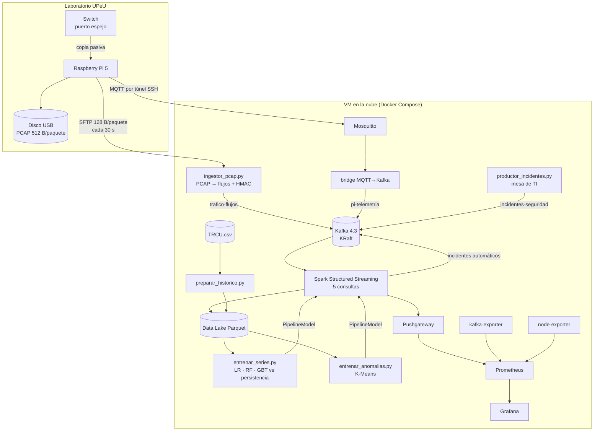

# Arquitectura

## 1. Vista general: arquitectura Lambda

Una sola fuente física (el tráfico del laboratorio) alimenta dos capas:

- **Capa batch:** el histórico `TRCU.csv` (2 meses de flujos reales) se limpia,
  se valida y se guarda en Parquet particionado; sobre él se entrenan los
  modelos (series de tiempo y K-Means).
- **Capa de velocidad:** el tráfico en vivo llega cada 30 s desde el Raspberry
  Pi, se convierte en flujos, pasa por Kafka y Spark Structured Streaming lo
  agrega en ventanas, le aplica los modelos y publica resultados.
- **Capa de servicio:** Prometheus + Grafana (tablero) y el tópico
  `incidentes-seguridad` (tickets para la mesa de TI).

Lo que une ambas capas es **una sola función de agregación**
(`agregar_por_minuto()` en `nube/spark/jobs/comun.py`), usada igual en batch y
en streaming: el modelo ve en vivo exactamente las mismas variables con las que
se entrenó.

## 2. Componentes

**Tabla 1. Qué corre dónde**

| Lugar | Componente | Tecnología | Qué hace |
|---|---|---|---|
| Pi | `nids-captura` | tcpdump | Captura pasiva en el puerto espejo, un PCAP cada 30 s al disco USB |
| Pi | `nids-subida` | editcap + SFTP | Recorta cada PCAP a 128 B/paquete (solo cabeceras), lo sube y aplica retención local |
| Pi | `nids-tunel` | autossh | Túnel SSH hacia el MQTT de la nube |
| Pi | `nids-telemetria` | Python + paho-mqtt | Temperatura, CPU, disco, paquetes descartados cada 5 s |
| Nube | `ingestor` | Python + dpkt + kafka-python | Reconstruye flujos bidireccionales, seudonimiza IP y publica en Kafka |
| Nube | `kafka` + `kafka-topicos` | Apache Kafka 4.3 (KRaft) | Bus de eventos; 3 tópicos de 3 particiones |
| Nube | `mosquitto` + `bridge` | Mosquitto 2 + Python | Puerta de entrada IoT (patrón de S7) |
| Nube | `incidentes` | Python | Evento empresarial: tickets de la mesa de TI |
| Nube | `spark-streaming` | Spark 4.2 Structured Streaming | 5 consultas con ventanas, watermark y checkpoint |
| Nube | `spark-entrenamiento` | Spark 4.2 MLlib | Reentrena las series de tiempo cada 6 h |
| Nube | `prometheus`, `pushgateway`, exporters | Prometheus 3 | Métricas del pipeline, del modelo y de la VM |
| Nube | `grafana` | Grafana 11 | Tablero único, aprovisionado como código |

## 3. Decisiones técnicas

| Decisión | Alternativa descartada | Por qué |
|---|---|---|
| El Pi solo captura; todo el análisis en la nube | Procesar en el Pi | Los 4 núcleos ARM no sostienen captura + análisis sin perder paquetes; si el análisis falla, la captura sigue |
| Subir solo cabeceras (128 B) | Subir el PCAP completo | 10-20 veces menos datos; no viaja contenido de nadie; los largos reales salen de las cabeceras IP |
| Flujos en el ingestor, no paquetes en Kafka | Un evento por paquete | Decenas de veces menos eventos en Kafka y las mismas columnas que el histórico TRCU.csv |
| MQTT + puente para la telemetría | Que el Pi hable Kafka | Patrón IoT de S7: el dispositivo no depende del cliente Kafka ni expone el broker |
| Túnel SSH | Abrir MQTT/Kafka a internet | Un solo puerto (22/443) y autenticación por clave; nada más expuesto |
| Seudonimización HMAC en el ingestor | Guardar IP reales | Ley 29733: las IP institucionales son dato personal; la misma IP da siempre el mismo seudónimo |
| Pushgateway para métricas de Spark | Exporter propio | Atajo de S11 para un job que no termina; documentado como tal |
| Una función de agregación para batch y streaming | Dos implementaciones | Evita que el modelo vea en vivo variables distintas a las del entrenamiento |
| Docker Compose en una VM | Kubernetes / servicios gestionados | Reproducible con un comando y dentro del crédito de estudiante |

## 4. Flujo de un dato, de punta a punta

1. Un estudiante abre una página: el switch copia sus paquetes al puerto espejo.
2. `tcpdump` en el Pi los escribe en el PCAP del bloque de 30 s actual.
3. Al cerrar el bloque, `nids-subida` lo recorta a cabeceras y lo sube por SFTP.
4. El `ingestor` reconstruye las conexiones; cuando una termina (FIN/RST,
   30 s sin paquetes o 2 min), publica un evento en `trafico-flujos`.
5. Spark agrega los flujos por minuto (watermark de 4 min), calcula KPIs, los
   rezagos, aplica el modelo de cada indicador y el K-Means a cada flujo.
6. Si algo supera su umbral, Spark publica un incidente en `incidentes-seguridad`.
7. Las métricas van a Pushgateway → Prometheus → Grafana (refresco de 30 s).

Latencia típica de punta a punta: **1-5 minutos** (30 s de bloque + cierre del
flujo + watermark), visible en el panel "Latencia extremo a extremo".
