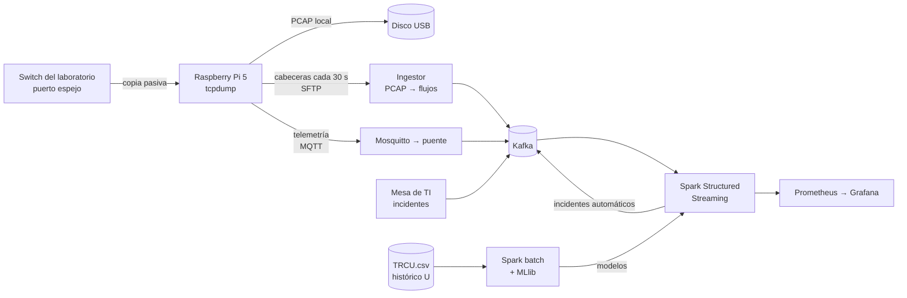

# NIDS campus — tráfico de red en tiempo real

**Curso:** Big Data · UPeU 2026-2
**Equipo:** Nick Saim Mayta Jara · David Romero Nina · Henyelrey Lucio Garcia Chura · Jhan Logan Ramos Quispe

## El problema

La mesa de TI de un campus se entera de los problemas de red cuando alguien ya
se quejó: un equipo infectado que escanea la red, una descarga que satura el
laboratorio, un malware que consulta DNS sin parar. Para entonces el incidente
ya ocurrió.

**Pregunta central de negocio:** *¿cómo detectar a tiempo comportamientos
anómalos en el tráfico de red del laboratorio para que la mesa de TI reaccione
antes de que se conviertan en incidentes?*

## La solución en una frase

Un **Raspberry Pi 5** conectado a un **puerto espejo** del switch captura
pasivamente el tráfico del laboratorio; la nube lo convierte en flujos, lo
procesa con **Kafka + Spark Structured Streaming**, lo compara contra **modelos
entrenados con 2 meses de tráfico real de la universidad** y muestra en
**Grafana**, minuto a minuto, el tráfico, su predicción y las anomalías, que
además se convierten automáticamente en **tickets de incidente**.

## Qué hay en esta documentación

| Sección | Contenido |
|---|---|
| [Brief del proyecto](brief.md) | Equipo y roles, pregunta central, las 8 dimensiones con sus fichas y requisitos, evolución desde la U1 |
| [Arquitectura](arquitectura.md) | Lambda, componentes, decisiones técnicas |
| [Sensor Raspberry Pi](sensor.md) | Captura pasiva, retención, telemetría, túnel |
| [Ingesta y contratos](ingesta.md) | Tópicos de Kafka y contratos de evento versionados |
| [Procesamiento streaming](streaming.md) | Ventanas, watermarking, checkpointing, semántica de entrega |
| [Capa batch](batch.md) | ETL del histórico, calidad, Parquet particionado |
| [Modelos de ML](modelos.md) | Series de tiempo validadas contra persistencia y detector K-Means |
| [Tablero Grafana](dashboard.md) | Qué muestra cada panel |
| [Observabilidad](observabilidad.md) y [Costos](costos.md) | Métricas del pipeline, umbrales y costo de escalar |
| Integrantes | Una página por persona con su dimensión U1 y U2 |
| Notebooks | Los 5 notebooks PySpark ejecutados con datos reales |
| [Despliegue](despliegue.md) | Cómo reproducir todo desde cero |
| [Rúbrica y evidencias](rubrica.md) | Cada criterio de la rúbrica con su evidencia verificable |

## Estado

| Componente | Estado |
|---|---|
| Stack en la nube (Azure, Docker Compose, 14 servicios) | ✅ En producción |
| Histórico TRCU.csv (397 354 flujos, 1-jul a 1-sep-2026) | ✅ Procesado |
| Modelos de serie de tiempo (4 indicadores) | ✅ Entrenados y en vivo |
| Detector K-Means por flujo | ✅ Entrenado y en vivo |
| Sensor Raspberry Pi 5 | ✅ Probado de punta a punta; se instala en la U el 30-oct-2026 |
| Tablero Grafana | ✅ Público con contraseña |
