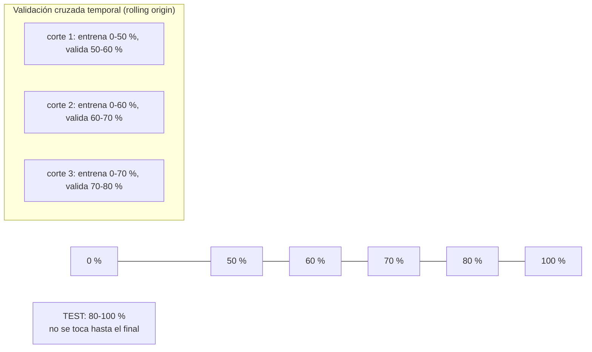

# Modelos de Machine Learning

El proyecto tiene **dos familias de modelos**, ambas entrenadas con Spark MLlib
sobre el histórico real `TRCU.csv` y aplicadas en vivo dentro de Spark
Structured Streaming:

| Modelo | Pregunta | Tipo | Unidad | Código |
|---|---|---|---|---|
| Series de tiempo (×4) | ¿Cuánto habrá el minuto siguiente? | Regresión supervisada | minuto | `entrenar_series.py` |
| Detector de anomalías | ¿Esta conexión es rara? | Clustering no supervisado | flujo | `entrenar_anomalias.py` |

¿Por qué no un clasificador de ataques? Porque **el histórico no tiene
etiquetas** (`label = NeedLabel` en el 100 % de las filas). Entrenar un
clasificador exigiría inventar etiquetas. Las series de tiempo usan como
"etiqueta" el propio valor del minuto siguiente, y el K-Means no necesita etiquetas.

## 1. Series de tiempo: una por integrante

### 1.1 Dataset supervisado

- **Fuente:** `historico_minuto` (TRCU.csv) más `trafico_minuto` (lo que ya llegó en vivo).
- **Objetivo:** `lead(indicador, 1)`, el valor del minuto siguiente.
- **Solo pares de minutos consecutivos:** si el sensor estuvo apagado, el
  "minuto siguiente" no existe y la fila se descarta.
- **26 316 filas** útiles.

**Variables (32):**
- **Estado del minuto (12):** paquetes, bytes, flujos, hosts, tcp, udp, dns,
  bytes_tls, syn, bytes_externos, hora y día de la semana.
- **Rezagos (20):**
  - `lag1`, `lag2` y `lag3` de cada uno de los 4 indicadores;
  - la media móvil de 5 minutos de cada indicador;
  - `gap_min`, los minutos desde la fila anterior.

Los rezagos se calculan con funciones de ventana en batch (`con_rezagos()`) y
con una memoria de 5 filas en streaming (`rezagos_fila()`). Las dos implementaciones son equivalentes.

**Decisión propia: inferencia con estado.** La forma más simple de inferir en
streaming es sin estado: cada ventana se predice solo con su propia fila. La
probamos y el modelo quedaba **peor que la persistencia** (en bytes, 66 % peor
en test). Con los rezagos le gana en los 4 indicadores. El costo es guardar 5
filas por sensor en el driver, que es poco. Para que un reinicio no las pierda,
se reconstruyen desde el Data Lake (`precargar_historial()`) antes de procesar
el primer lote.

### 1.2 Protocolo de validación

1. **Test = el último 20 % del tiempo** (5264 minutos). No participa en ninguna decisión.
2. **Selección de hiperparámetros con validación cruzada temporal**, en 3
   cortes que siempre entrenan con el pasado y validan con el futuro inmediato. Nunca se usa `randomSplit`.
3. **Grilla de búsqueda**, de 12 configuraciones por indicador (36 entrenamientos):
   - LinearRegression: `regParam` ∈ {0, 0,1}
   - RandomForest: `maxDepth` ∈ {6, 10}, con 40 árboles
   - GBT: `maxDepth` ∈ {3, 5}, con 50 iteraciones
   - y para cada uno, la **escala**: original o `log1p`/`expm1`.
4. **Ganador:** el de menor RMSE promedio en validación. Se reentrena con todo
   lo anterior al test y se evalúa una sola vez en el test.
5. **Baseline obligatorio: persistencia** (el minuto siguiente es igual al actual).

**Por qué la escala logarítmica.** El tráfico tiene cola pesada: la mayoría de
los minutos son tranquilos y unos pocos tienen picos de MB. En escala original,
los árboles persiguen los picos y fallan en el resto. Aprender en `log1p` y
volver con `expm1` lo estabiliza. Se deja como hiperparámetro y que decida la validación.

### 1.3 Resultados en test (datos reales, 30-oct-2026)

**Tabla 1. RMSE en test y mejora sobre la persistencia**

| Integrante | Indicador | Persistencia | LinearRegression | RandomForest | GBT | Ganador (por CV) | Mejora |
|---|---|---:|---:|---:|---:|---|---:|
| David | bytes/min | 148 264 | 126 100 | 126 945 | **124 294** | GBT, log, prof. 3 | **+16,2 %** |
| Nick | flujos/min | 10,32 | 6,67 | **5,60** | 6,29 | RF, original, prof. 10 | **+45,8 %** |
| Henyelrey | SYN/min | 1,139 | 2,313 | 1,976 | **1,006** | GBT, log, prof. 5 | **+11,6 %** |
| Jhan | DNS/min | 0,734 | 0,595 | 0,604 | **0,593** | RF, log, prof. 6 | **+17,6 %** |

**Tabla 2. MAE y R² en test del ganador frente a la persistencia**

| Indicador | MAE persistencia | MAE ganador | R² persistencia | R² ganador |
|---|---:|---:|---:|---:|
| bytes | 24 340 | 13 997 (−43 %) | −0,33 | 0,06 |
| flujos | 6,76 | 2,93 (−57 %) | −0,24 | 0,63 |
| syn | 0,254 | 0,218 (−14 %) | 0,79 | 0,84 |
| dns | 0,170 | 0,144 (−15 %) | −0,23 | 0,17 |

**Lectura honesta:**
- **Los 4 modelos le ganan a la persistencia en un test que nunca vieron.** Por eso se justifican.
- **Flujos** es el indicador más predecible (R² 0,63).
- En **bytes**, el R² es bajo (0,06): los picos de descarga son difíciles de anticipar
  un minuto antes. Aun así el error típico (MAE) baja 43 %.
- En **SYN**, la persistencia ya era buena (R² 0,79), y el modelo la mejora sin empeorarla.
- En **DNS**, la validación eligió RF y en test GBT quedó apenas mejor (0,593
  contra 0,604). Se respeta la elección de la validación: elegir mirando el test sería hacer trampa.

**Variables más importantes:**
- en **flujos**, los rezagos de flujos (`lag3_flujos`, `media5_flujos`);
- en **bytes**, los minutos desde el dato anterior y los rezagos de flujos y bytes;
- en **DNS**, la media móvil de DNS.

Es decir, la memoria reciente es lo que más predice, y es justo lo que el modelo sin rezagos no tenía.

### 1.4 En producción

- Reentrenamiento automático cada 6 h con el histórico más lo que llegó en vivo.
- `streaming_nids.py` recarga el modelo nuevo sin reiniciar.
- **Anomalía de serie de tiempo:** `real > predicción + 3·RMSE_test`. Abre un
  incidente (`anomalia_trafico`, o `escaneo_red` si es SYN).

## 2. Detector de anomalías por flujo (K-Means)

### 2.1 Variables por flujo

Escala logarítmica, porque bytes y paquetes van de 1 a millones:

- paquetes de ida y de vuelta;
- bytes de ida y de vuelta;
- duración en ms;
- cantidad de SYN (con tope de 10);
- si es TCP o UDP;
- si el puerto es conocido (< 1024);
- si el destino está dentro del campus.

Todas pasan por un `StandardScaler` con media y desviación.

### 2.2 Elección de k

**Tabla 3. Silhouette por k (muestra de 60 000 flujos)**

| k | 4 | **6** | 8 | 10 |
|---|---:|---:|---:|---:|
| Silhouette | 0,780 | **0,830** | 0,796 | 0,830 |

Se elige **k = 6**. Empata con k = 10, pero es más simple.

### 2.3 Puntaje y umbral

- **Puntaje de anomalía:** la distancia euclidiana del flujo (escalado) al centro de su cluster.
- **Umbral:** el **percentil 99,5** del puntaje en los 397 354 flujos
  históricos, que da **6,31**. En el histórico, 1937 flujos lo superan (0,49 %).
- En vivo, un flujo con puntaje mayor a 6,31 es **anómalo**:
  - se guarda en `lake/anomalias_flujo`;
  - aparece en la tabla de flujos sospechosos de Grafana;
  - si hay al menos uno en el micro-batch, abre un incidente (severidad alta si son 5 o más).

**Tamaño de los clusters:** 279 633 · 74 600 · 20 368 · 12 162 · 7386 · 3205
flujos. Los clusters chicos agrupan comportamientos poco frecuentes, como
conexiones largas o servicios raros.

## 3. Cierre del ciclo: del modelo al negocio

Cuando cualquiera de los dos modelos detecta algo, Spark publica un evento
`incidente.abierto` en `incidentes-seguridad` con:
- `reportadoPor: "nids-modelo"`;
- una `evidencia` legible (qué se observó y contra qué umbral).

Hay un límite de un incidente por motivo cada 10 minutos. El evento empresarial
deja de ser solo simulado y **nace del propio modelo**. En Grafana se separan
los incidentes abiertos por la mesa de TI de los abiertos por el modelo.
