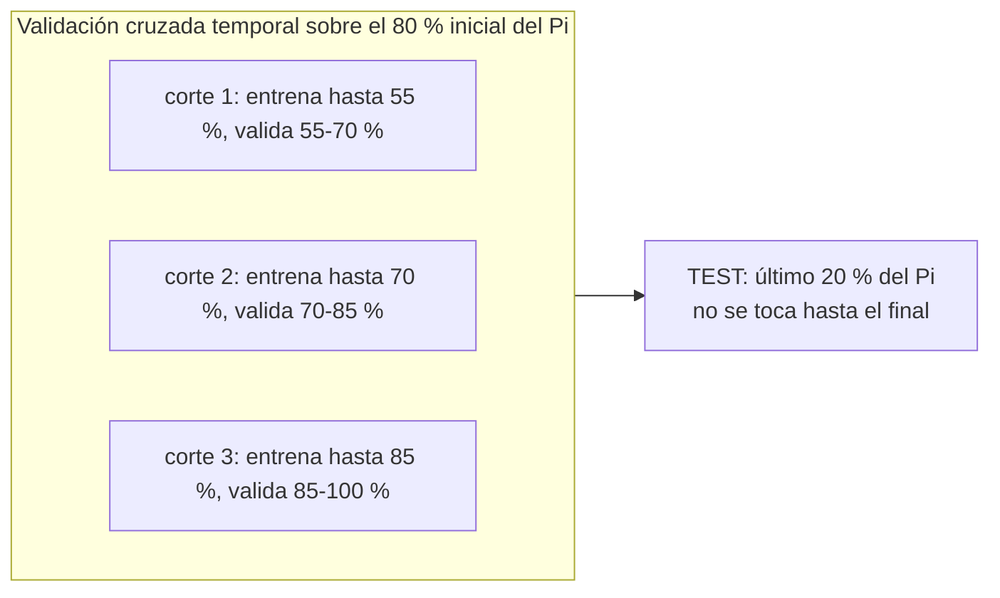

# Modelos de Machine Learning

El proyecto tiene **dos familias de modelos**, entrenadas con Spark MLlib y
aplicadas en vivo dentro de Spark Structured Streaming. El K-Means usa el
histórico `TRCU.csv`; las series de tiempo usan ese histórico y los datos del Pi:

| Modelo | Pregunta | Tipo | Unidad | Código |
|---|---|---|---|---|
| Series de tiempo (×4) | ¿Cuánto habrá el minuto siguiente? | Regresión supervisada | minuto | `entrenar_series.py` |
| Detector de anomalías | ¿Esta conexión es rara? | Clustering no supervisado | flujo | `entrenar_anomalias.py` |

¿Por qué no un clasificador de ataques? Porque **el histórico no tiene
etiquetas** (`label = NeedLabel` en el 100 % de las filas). Entrenar un
clasificador exigiría inventar etiquetas. Las series de tiempo usan como
"etiqueta" el propio valor del minuto siguiente, y el K-Means no necesita etiquetas.

## 1. Series de tiempo: una por integrante

### 1.1 Dataset supervisado

- **Fuente:** `historico_minuto` (TRCU.csv) más `trafico_minuto` (lo que ya llegó en vivo).
  Del Pi se usan solo los datos desde que está en su punto actual (30-oct-2026, 10:40).
- **Objetivo:** `lead(indicador, 1)`, el valor del minuto siguiente.
- **Solo pares de minutos consecutivos:** si el sensor estuvo apagado, el
  "minuto siguiente" no existe y la fila se descarta.
- **Filas útiles (6-nov-2026):** 26 314 del histórico y 10 087 del Pi.

**Variables (32):**
- **Estado del minuto (12):** paquetes, bytes, flujos, hosts, tcp, udp, dns,
  bytes_tls, syn, bytes_externos, hora y día de la semana.
- **Rezagos (20):**
  - `lag1`, `lag2` y `lag3` de cada uno de los 4 indicadores;
  - la media móvil de 5 minutos de cada indicador;
  - `gap_min`, los minutos desde la fila anterior.

Los rezagos se calculan con funciones de ventana en batch (`con_rezagos()`) y
con una memoria de 5 filas en streaming (`rezagos_fila()`). Las dos implementaciones son equivalentes.

**Decisión propia: inferencia con estado.** La forma más simple de inferir en
streaming es sin estado: cada ventana se predice solo con su propia fila. La
probamos y el modelo quedaba **peor que la persistencia** (en bytes, 66 % peor
en test). Con los rezagos le gana en los 4 indicadores. El costo es guardar 5
filas por sensor en el driver, que es poco. Para que un reinicio no las pierda,
se reconstruyen desde el Data Lake (`precargar_historial()`) antes de procesar
el primer lote.

### 1.2 Protocolo de validación

1. **Test = el último 20 % del tiempo del Pi** (2018 minutos en la corrida del 6-nov). No participa en la selección.
2. **Selección con validación cruzada temporal**, en 3 cortes que siempre
   entrenan con el pasado y validan con el futuro inmediato del Pi. Nunca se usa `randomSplit`.
3. **Grilla de búsqueda**, de 12 configuraciones por cada una de las dos
   estrategias, solo el Pi o histórico + Pi (72 entrenamientos por indicador):
   - LinearRegression: `regParam` ∈ {0, 0,1}
   - RandomForest: `maxDepth` ∈ {6, 10}, con 40 árboles
   - GBT: `maxDepth` ∈ {3, 5}, con 50 iteraciones
   - y para cada uno, la **escala**: original o `log1p`/`expm1`.
4. **Ganador:** el de menor RMSE promedio en validación. Se reentrena con todo
   lo anterior al test y se evalúa en el test.
5. **Baseline obligatorio: persistencia** (el minuto siguiente es igual al actual).
6. **Compuerta de publicación:** el modelo en producción solo cambia si, en el
   mismo test, el candidato le gana a la persistencia, mejora el RMSE actual al
   menos 1 % y no empeora el MAE más de 10 %. Se publica el mismo modelo medido.

**Por qué la escala logarítmica.** El tráfico tiene cola pesada: la mayoría de
los minutos son tranquilos y unos pocos tienen picos de MB. En escala original,
los árboles persiguen los picos y fallan en el resto. Aprender en `log1p` y
volver con `expm1` lo estabiliza. Se deja como hiperparámetro y que decida la validación.

### 1.3 Resultados en producción (6-nov-2026)

Flujos, SYN y DNS se midieron en los últimos 2018 minutos del Pi. Bytes conserva
el modelo entrenado con el histórico porque el candidato que eligió la
validación no superó la compuerta; sus cifras siguen siendo las del test del
histórico. **Por eso su porcentaje no se compara con los de las otras filas.**

**Tabla 1. RMSE en test y mejora sobre la persistencia**

| Integrante | Indicador | Test | Persistencia | LinearRegression | RandomForest | GBT | En producción | Mejora |
|---|---|---|---:|---:|---:|---:|---|---:|
| David | bytes/min | Histórico | 146 021 | 101 750 | 101 422 | **99 893** | GBT, log, solo histórico | **+31,6 %** |
| Nick | flujos/min | Pi | 14,15 | **12,07** | 12,30 | 12,67 | LR, original, solo Pi | **+14,7 %** |
| Henyelrey | SYN/min | Pi | 2,81 | **2,14** | 2,24 | 2,28 | LR, original, histórico + Pi | **+24,1 %** |
| Jhan | DNS/min | Pi | 2,92 | **2,22** | 2,27 | 2,46 | LR, original, histórico + Pi | **+23,9 %** |

**Tabla 2. MAE y R² en test del modelo en producción frente a la persistencia**

| Indicador | MAE persistencia | MAE modelo | R² persistencia | R² modelo |
|---|---:|---:|---:|---:|
| bytes | 23 982 | 12 560 (−48 %) | −1,04 | 0,05 |
| flujos | 8,80 | 7,58 (−14 %) | 0,53 | 0,66 |
| syn | 1,18 | 0,98 (−17 %) | −0,16 | 0,33 |
| dns | 1,16 | 0,96 (−17 %) | −0,16 | 0,33 |

**Tabla 3. Comparación en los últimos 2018 minutos del Pi**

| Indicador | RMSE modelo anterior | RMSE candidato | Mejora del anterior vs persistencia | Decisión |
|---|---:|---:|---:|---|
| bytes | 168 282 | 173 103 | +21,2 % | Se conserva el anterior: el candidato es peor y duplica el MAE |
| flujos | 18,46 | 12,07 | −30,5 % | Se publica |
| syn | 2,32 | 2,14 | +17,5 % | Se publica |
| dns | 2,51 | 2,22 | +14,1 % | Se publica |

**Lectura honesta:**
- **Los 4 modelos le ganan a la persistencia en su test.** El de bytes y los de
  los otros tres indicadores se prueban con datos distintos.
- **El modelo anterior de flujos perdía contra la persistencia en datos del Pi**,
  aunque en el histórico le ganaba. Es deriva de datos: el sensor ve otra red.
- En **bytes**, el R² es bajo (0,05): los picos de descarga son difíciles de
  anticipar un minuto antes. Aun así el error típico (MAE) baja 48 %.
- **El RMSE es muy sensible a pocos picos.** En bytes, quitar 2 filas de prueba del
  histórico movió la mejora de +16,2 % a +31,6 %; el MAE es más estable (−43 % a −48 %).
- En los tres indicadores publicados, la validación eligió la regresión lineal
  sobre los modelos más complejos.

**Cifras del PPT de la sustentación (30-oct-2026).** Se midieron solo con el
histórico: bytes +16,2 %, flujos +45,8 %, SYN +11,6 % y DNS +17,6 %. No son
comparables con las de flujos, SYN y DNS de la Tabla 1.

### 1.4 En producción

- Reentrenamiento automático cada 6 h con el histórico y los datos del Pi; cada
  corrida tarda alrededor de 1 h y pasa por la compuerta de publicación.
- El contenedor de entrenamiento tiene límites de memoria (2,2 GB) y CPU (1,5).
- `streaming_nids.py` recarga el modelo nuevo sin reiniciar.
- **Anomalía de serie de tiempo:** `real > predicción + 3·RMSE_test`. Abre un
  incidente (`anomalia_trafico`, o `escaneo_red` si es SYN).
- **Una anomalía no prueba un ataque:** significa que el valor se salió de lo
  esperado. La categoría `escaneo_red` hoy es una señal débil, porque se basa solo
  en el conteo de SYN, que también incluye respuestas de servidores.
- **Si el Pi cambia de puerto** hay que mover `INICIO_SENSOR` y reentrenar: el
  tráfico anterior deja de representar lo que el sensor va a ver.

## 2. Detector de anomalías por flujo (K-Means)

### 2.1 Variables por flujo

Escala logarítmica, porque bytes y paquetes van de 1 a millones:

- paquetes de ida y de vuelta;
- bytes de ida y de vuelta;
- duración en ms;
- cantidad de SYN (con tope de 10);
- si es TCP o UDP;
- si el puerto es conocido (< 1024);
- si el destino está dentro del campus.

Todas pasan por un `StandardScaler` con media y desviación.

### 2.2 Elección de k

**Tabla 3. Silhouette por k (muestra de 60 000 flujos)**

| k | 4 | **6** | 8 | 10 |
|---|---:|---:|---:|---:|
| Silhouette | 0,780 | **0,830** | 0,796 | 0,830 |

Se elige **k = 6**. Empata con k = 10, pero es más simple.

### 2.3 Puntaje y umbral

- **Puntaje de anomalía:** la distancia euclidiana del flujo (escalado) al centro de su cluster.
- **Umbral:** el **percentil 99,5** del puntaje en los 397 354 flujos
  históricos, que da **6,31**. En el histórico, 1937 flujos lo superan (0,49 %).
- En vivo, un flujo con puntaje mayor a 6,31 es **anómalo**:
  - se guarda en `lake/anomalias_flujo`;
  - aparece en la tabla de flujos sospechosos de Grafana;
  - si hay al menos uno en el micro-batch, abre un incidente (severidad alta si son 5 o más).

**Tamaño de los clusters:** 279 633 · 74 600 · 20 368 · 12 162 · 7386 · 3205
flujos. Los clusters chicos agrupan comportamientos poco frecuentes, como
conexiones largas o servicios raros.

## 3. Cierre del ciclo: del modelo al negocio

Cuando cualquiera de los dos modelos detecta algo, Spark publica un evento
`incidente.abierto` en `incidentes-seguridad` con:
- `reportadoPor: "nids-modelo"`;
- una `evidencia` legible (qué se observó y contra qué umbral).

Hay un límite de un incidente por motivo cada 10 minutos. El evento empresarial
deja de ser solo simulado y **nace del propio modelo**. En Grafana se separan
los incidentes abiertos por la mesa de TI de los abiertos por el modelo.
