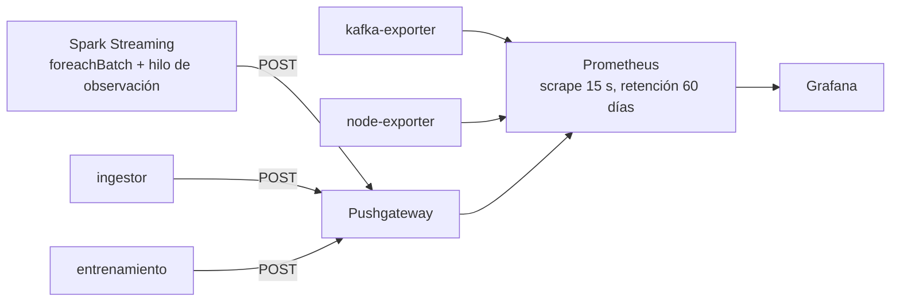

# Observabilidad

## 1. Cómo llegan las métricas a Grafana

- **Spark:** un hilo lee `lastProgress` de cada consulta cada 15 s (filas de
  entrada, filas/s, duración del batch, watermark, offsets) y calcula el **lag**
  = último offset de Kafka − offset procesado.
- **Kafka:** `kafka-exporter` (offsets por tópico y partición).
- **VM:** `node-exporter` (CPU, RAM, disco, red).
- **Sensor:** la telemetría del Pi viaja como evento IoT y Spark la agrega.

## 2. Métricas y umbrales

**Tabla 1. Métricas del pipeline correlacionadas**

| Métrica | Normal | Alerta | Qué significa si se dispara |
|---|---|---|---|
| `nids_spark_lag_kafka_registros` | 0 | > 0 sostenido 10 min | Backpressure: entra más de lo que Spark procesa |
| `nids_spark_duracion_batch_ms` | < 5 000 | > 20 000 (trigger) | El micro-batch no termina antes del siguiente |
| `nids_trafico_latencia_ventana_segundos` | 60-300 | > 600 | Los datos llegan tarde (red del campus, subida) |
| `time() - nids_ingestor_ultimo_archivo_timestamp` | < 60 | > 300 | El Pi se apagó o perdió red |
| `nids_pi_descartados` | 0 | > 0 | El kernel del Pi no alcanza a capturar |
| `nids_pi_temp_max` | < 65 °C | > 80 °C | El Pi se calienta (ventilación) |
| `nids_pi_disco_libre_gb` | — | < 10 GB | La retención empezará a borrar lo más viejo |
| CPU de la VM | < 60 % | > 80 % sostenido | Hay que escalar la VM |

**Correlación que se lee en el tablero:** si "Mensajes/s publicados" sube y el
lag sube con él mientras la duración del batch pasa los 20 s, el cuello es
Spark; si los mensajes/s caen a 0 y los segundos desde el último archivo suben,
el problema es el sensor o su red, no la nube.

## 3. Riesgos operativos

| Riesgo | Mitigación |
|---|---|
| Se corta la luz en el laboratorio | Todos los servicios del Pi arrancan solos; el panel de último archivo lo evidencia |
| La red del campus bloquea el puerto 22 | SSH también en el 443 |
| La nube no responde | El Pi sigue capturando al disco local; lo atrasado > 30 min queda solo local |
| Un reinicio de Spark | Checkpoints: retoma desde el último offset confirmado; los rezagos se recargan del Data Lake |
| Un tópico no existe todavía | `kafka-topicos` los crea antes de que arranque Spark |
| Disco del Pi lleno | Retención en anillo; nunca se detiene la captura |
